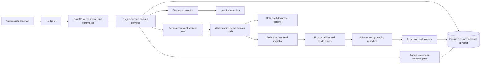

# Architecture — accepted foundation and Phase 2

Phase 2 ingestion/evidence/search is implemented; [INGESTION_AND_STORAGE](INGESTION_AND_STORAGE.md) records current behavior/limits. Later AI/governance/jobs below remain future design; the accepted Phase 1 foundation was extended without redesign.

## Implemented Phase 2 boundary

Sources/Evidence/Knowledge routers reuse authenticated ProjectContext. Immutable SourceVersion raw metadata is separate from ParseRun/ParsedSection history. Composite FKs, RLS, transaction-local actor and explicit editor/confirmer policies cover five new tables. Private local storage sits behind Storage; scoped audited downloads expose originals. Small uploads parse synchronously through a bounded subprocess/thread pool; distributed jobs/automatic reconciliation are deferred. PostgreSQL lexical search includes all active-source versions, each with its latest successful parse; inactive inclusion is explicit. No embeddings/AI/approval were added.

Phase 0/1 are accepted. Phase 2 ingestion is implemented as described above; later AI/governance/jobs sections remain design. Product authority: [scope](../01_Project_Setup/Medical_BA_AI_MVP_Development_Scope_v1.0.md), DEC-MVP-001–007 and DEC-P2-001–006. Current setup: [local development](LOCAL_DEVELOPMENT.md). Open policies: [decision register](BASELINE_ASSESSMENT.md).

## Implemented Phase 1 boundary

FastAPI routers call auth/project services and explicitly scoped repository queries. SQLAlchemy persists only User, AuthSession, Project, ProjectMember, AuditLog and platform SecurityEvent, with Alembic migrations. Next.js provides login, projects/create, workspace and settings/members screens, plus a same-origin API rewrite. Runtime packages are pinned in `backend/uv.lock` and `frontend/package-lock.json`. Synthetic PostgreSQL integration and browser tests exercise the actual services.

Local identity is email/password with Argon2id hashes; future external identities can map to stable User IDs without changing domain FKs. Opaque cookies are revocable, hashed in the DB, HttpOnly/SameSite Strict; explicit Origin plus CSRF protects mutations. Eight-hour lifetime and bounded login throttling are configurable development defaults. Production config requires Secure cookies/HTTPS origins. Operator-only CLI provisioning supplies no known credentials or private-project membership.

Project roles are PROJECT_ADMIN, BA, BUSINESS_OWNER, MEDICAL_SME, TECH, QC, VIEWER. Global system-admin status does not bypass project membership. One role per membership is the current reversible MVP interpretation. Active members can read project context/members; only PROJECT_ADMIN can edit context, manage other memberships or view project audit. Self-membership changes are rejected. Project creation grants creator PROJECT_ADMIN, without business/medical authority. Grant policy and production separation remain explicitly documented assumptions.

Row policies apply to projects, memberships and project audit. Authorization functions are narrow SECURITY DEFINER predicates with pinned search paths; table-owner bypass is restricted to operator/migration access. The runtime DB role is non-owner without BYPASSRLS/superuser, enforced at startup. The backend sets authenticated actor context transaction-locally. Membership bootstrap permits only the creator's first PROJECT_ADMIN row. Audit/security events reject UPDATE/DELETE even for ordinary owner writes; runtime grants further deny audit mutation. Domain mutation and audit commit together. Project/membership identities cannot be moved or rewritten.

DEC-MVP-006 resolves A03: formal CR is mandatory after BASELINED; pre-baseline editing uses controlled new versions and fresh review, never historical mutation. DEC-MVP-007 resolves default clinical review to false; detected clinical impact makes Medical SME review mandatory. These are locked design rules for later phases, not implemented approval/analysis features.

## Chosen stack and boundaries

Use the user's default: Next.js/React/TypeScript frontend; Python/FastAPI/Pydantic/SQLAlchemy/Alembic backend; PostgreSQL; optional pgvector in PostgreSQL when semantic retrieval is needed. There is no pre-existing application stack to preserve. Begin as a modular monolith. Local filesystem storage sits behind a `Storage` interface; an S3-compatible adapter may be added later without changing domain services. `LLMProvider` isolates model APIs. Environment variables supply deployment configuration and secrets.

Verified local versions are Python 3.13.15, PostgreSQL 17.11, Node 24.21.0, FastAPI 0.141.1, SQLAlchemy 2.0.54, Alembic 1.20.0, Next.js 16.3.6 and React 19.3.0. Python/npm dependencies have lockfiles. Docker Compose is configured but unexecuted because Docker is absent; its image tag still needs a deployment-specific digest before release.

Only the backend owns business authorization, lifecycle transitions, persistence and artifact selection. UI checks improve usability but are never the security boundary. Next.js guidance likewise distinguishes optimistic UI checks from checks near data access; use that principle while keeping this system's enforcement in FastAPI. [Next.js authentication guidance](https://nextjs.org/docs/app/guides/authentication)

## Module responsibilities

| Backend module | Owns |
|---|---|
| auth | User identity, sessions, project capabilities, bootstrap policy |
| projects / stakeholders | Membership, context revisions, scope, owners, external actors |
| sources / evidence / knowledge | Original bytes, parser attempts, evidence locations, chunks, retrieval and conflicts |
| requirements / business_rules | Stable identities, content revisions, AC, requirement relationships |
| questions / assumptions / decisions / risks | Attributed gap resolution and distinct record lifecycles |
| specifications | Data dictionary, business permission specifications, integration inventory, NFR detail, glossary/regulations, UAT drafts |
| analysis / ai | Structured BA orchestration, provider adapter, prompt versions, validation, output promotion |
| governance | Review assignments, human confirmations, approval/baseline/supersession policies |
| traceability | Valid typed edges, reverse navigation, broken/stale link checks |
| changes | CRs, graph impact snapshots, human confirmation, replacement version creation |
| artifacts | Approved/draft input selection, rendering and immutable export manifests |
| audit / evaluation | Append-oriented action history, golden executions, feedback and incidents |
| core / storage / jobs | Shared settings, unit of work, authorized context, storage ports and durable execution |

Services call other modules through explicit service interfaces and share a database transaction where invariants require atomicity. No hospital-system adapters, independent microservices, or autonomous-agent workflow are introduced.

## Security and project isolation

1. Resolve identity from a server-validated session. Never trust client `actor_id`, `project_id`, role, approver or clinical clearance fields. Same-origin routing is proposed; session cookies are HttpOnly, Secure in deployed environments, and protected by CSRF/origin checks on mutations. Revoke sessions when access is withdrawn; no credential storage in browser localStorage (A01).
2. Resolve a `ProjectContext(user, project, capabilities)` after checking active membership. Every project repository operation requires it. All object IDs and linked IDs are resolved inside the project. Use a uniform not-found result for inaccessible objects to avoid disclosing their existence.
3. Store `project_id NOT NULL` on business tables, job inputs, retrieval chunks, AI outputs, artifacts and project audit. Composite foreign keys prevent a same-user or malicious request from linking A's records into B. Project ID is immutable on existing records. Identity/session/global security events are platform data, not project business records.
4. Add PostgreSQL RLS as defense in depth, with transaction-local identity/project context derived by the server. Use a non-owner runtime DB role without superuser/BYPASSRLS; enforce read and write policies. Test missing context, pooled-connection reuse and worker execution. RLS owners/superusers can bypass ordinary policies, so merely enabling RLS is insufficient. [PostgreSQL RLS documentation](https://www.postgresql.org/docs/current/ddl-rowsecurity.html)
5. Check project and source permissions before retrieval, before provider submission, and before returning a file/export/job result. Cache keys include project, user/access scope, source versions and policy revision; revocation invalidates access. Source-specific restrictions, if needed, must propagate to derived outputs (A06).
6. Storage keys are generated from server-side project/source/version IDs. Never join arbitrary filenames into storage paths. Keep files outside the public web root; downloads pass through authorization. Local ACLs protect storage; future signed URLs require bounded validity and fresh authorization.
7. User-controlled Markdown/HTML and model output render as text or sanitized Markdown. Reject active script content. XLSX/text exports neutralize formula injection. Uploads enforce format allowlists and resource bounds; do not execute Office macros, spreadsheet formulas, embedded scripts or remote links.
8. Admin manages access but has no implicit clinical/business approval. AI is an actor kind on runs/audit, not an approver login or member. Technical service accounts have no human-review capability. The proposed capability matrix is in the API plan; unresolved grant/separation rules remain A04/A05.

**ASSUMPTION — NEEDS CONFIRMATION (A06):** all project members may read ordinary project sources initially. The baseline's “source permissions respected” requirement still applies: do not ingest a restricted source under broader access until its permission policy is defined. No cross-project sharing is designed into MVP.

## Ingestion, evidence and retrieval

Register source metadata and preserve raw bytes with a checksum before parsing. An upload creates a SourceVersion and durable parse job in a recoverable sequence: stage file → commit registered version/job → promote immutable storage object. Reconcile abandoned staged files and failed finalization; never report READY before both persistence and extraction succeed. A parse failure is visible and retryable; original download remains available.

Parser adapters cover TXT/MD lines, PDF text pages/offsets, DOCX paragraphs/tables, CSV row/column, XLSX sheet/cell ranges. Preserve extracted text and coordinates; summaries do not replace exact extracts. Scanned PDFs return an explicit unsupported/no-extractable-text result. No OCR claim. Files and archives have bounded expanded size/time; parser processes have no outbound fetch behavior.

Source type (meeting/API doc/regulation) is separate from file format (PDF/DOCX/XLSX). Evidence always pins source version and a location. Chunks are retrieval material, not automatically Evidence or facts. Candidate evidence is validated against the extracted version before acceptance.

Use project-scoped PostgreSQL text retrieval first with selected sources and explicit source-status filters. Retrieve current ACTIVE sources and current approved/confirmed domain knowledge by default, but label raw source statements as unapproved evidence. Historical mode is explicit and visibly marked. Active conflicts must be included in context; no silent winner by timestamp or trust score. Confirmed decisions require an explicit supersede link to replace older truth.

When evaluation justifies semantic retrieval, add an `EmbeddingProvider` and pgvector columns/indexes keyed by project, chunk, model and dimension. Keep authorization filters in the query and test recall under filters; approximate search can return fewer candidates after filtering. No separate vector database is necessary for this design. [pgvector documentation](https://github.com/pgvector/pgvector)

## AI orchestration and output contract

One bounded analysis job performs: capture authorized context revision + source/version IDs + confirmed answers → retrieve allowed passages → build prompt → call provider → validate → persist structured outputs and audit. No tools are exposed that approve, write hospital data, fetch arbitrary URLs, or query arbitrary projects. A rerun creates a new run with `previous_run_id`, rather than overwriting history.

`LLMProvider.analyze(AnalysisRequest) -> AnalysisResponse` accepts a trusted template version, separate user task and labeled untrusted reference blocks, a JSON schema and configured resource budget. Adapter failures become sanitized typed errors. Provider/model identifiers and request correlation IDs are recorded without secrets. Actual live provider selection/data egress is A09; deterministic test doubles are labeled and cannot be advertised as working live AI.

Pydantic validates structure, enum values and extra fields; application validators enforce ownership/provenance, lifecycle and policy. Schema validation alone is not proof that a claim is true. [Pydantic model documentation](https://docs.pydantic.dev/latest/concepts/models/)

| Contract field | Planned shape / rule |
|---|---|
| summary, business_need, stakeholders, dimensions | Structured sections with citations or explicitly unknown status; dimensions cover scope, As-Is/To-Be, process, rules, data, permissions, integration, exceptions, NFR, security/privacy/audit, clinical/regulatory impact |
| facts, assumptions, questions, decisions_detected, risks, recommendations, action_items | Lists of typed items; seven canonical information classifications |
| draft_requirements, draft_business_rules, draft_acceptance_criteria | Typed proposals distinct from classification; always drafts, never inferred approvals |
| clinical_flags, conflicts | Flag reason, impacted item IDs, relevant references; unresolved conflict not collapsed into one rule |
| source_refs, evidence_refs, confirmation_refs | Authorized version-pinned IDs from the supplied context only |
| Each item | content, concise rationale, classification, proposed entity kind, optional confidence, references, requires_human_review=true, clinical_review_required, missing support, question priority where relevant |

Reject unknown citation IDs or cross-project references. FACT needs cited support or attributable human confirmation. A citation's existence is necessary but not sufficient: unsupported claims are withheld as facts, flagged for review, and converted to explicit gaps only with retained validation findings. Policy claims with numbers/thresholds require the specific supporting passage/confirmation; do not accept a random nearby number as evidence. No automatic guarantee of semantic entailment is claimed. Golden cases and human review cover that residual risk.

Clinical keyword/domain checks plus structured impact questions provide conservative routing; model output cannot disable a mandatory gate. Clearing false-positive clinical flags requires a separately authorized review decision (A02). Draft promotion creates linked domain records idempotently in one transaction; detected decisions remain PROPOSED. Promoted assumptions/recommendations cannot silently become approved requirements. Summaries follow the same grounding rules as individual facts.

Do not store hidden chain-of-thought. Store concise rationale, authorized citations, structured outputs, validation findings, review feedback, provider/model, prompt/schema version and source/context snapshot. Raw sensitive text is not copied into operational logs. Provider retention/redaction/region policies must be settled before real sensitive content is allowed.

## Governance, changes and artifacts

Content versions and lifecycle events are separate. Human reviews reference exact content hashes/versions, gate and reviewer identity. Editing a draft produces a new revision and resets review validity. Approval and baseline commands lock/recheck the version, membership, required reviews, provenance, unresolved blocking questions and conflicts, then commit state and audit together. UI cannot PATCH status. Immutable baseline constraints provide another guard against bypass.

A CR pins affected old versions. Deterministic graph traversal finds known neighbors; AI may explain or propose additional impacts with rationale. Missing links are flagged rather than invented. Humans confirm the impact snapshot and approve the CR. Applying it creates replacement drafts; it never edits the old baseline or automatically approves the replacement. Explicit supersession changes the current pointer atomically after required gates pass. Old content, reviews, edges and generated exports remain reproducible.

Artifacts have immutable versions and an input manifest of node/revision IDs. Default official specifications use current approved/baselined requirement content and active confirmed decisions/rules. Open question/risk logs retain their labels; draft packs and UAT drafts remain visibly marked. Generate a new draft artifact when a CR is pending; do not rewrite a prior official export. Markdown/text and XLSX are MUST; DOCX export is deferred unless separately chosen.

## Execution, reliability and deployment

**ASSUMPTION — NEEDS CONFIRMATION (A08):** a PostgreSQL job table and worker process from the same backend package handle parsing, AI and exports. Polling job endpoints keeps the initial UI simple. Jobs have durable states, leases, attempt metadata, idempotency keys, cancellation and sanitized failures. Recheck authorization at execution/result access and use transaction-local project scope. Retries cannot duplicate drafts, exports or audit approvals.

Use SQLAlchemy units of work, Alembic versioned migrations, compare-and-swap revisions and database constraints. Domain event + audit + job enqueue belong in the same transaction when applicable; external file/provider operations have explicit recoverable states. Baseline data remains intact on provider failure or worker crash. Do not log raw prompts/passwords/tokens/document payloads in server traces.

Phase 1 supplies Docker Compose for local PostgreSQL, backend/frontend dev commands, dependency locks, and migration/test automation after tooling is working. Production topology, TLS termination, key management, retention/deletion, backups/restore, RPO/RTO and capacity bounds remain deployment decisions, not invented SLAs. Synthetic fixtures are the default. Security/privacy review and a restore exercise remain release gates.

## Verification strategy

Use pytest against PostgreSQL for authorization/RLS/FKs, legal transitions, immutable baseline and concurrency behavior; SQLite is not sufficient evidence for these boundaries. Add parser fixtures for every required format, adversarial files, injection attempts and exact evidence locations. Test provider contract/validation with deterministic synthetic fixtures and run separately labeled live-provider evaluations. Use TypeScript/React component testing plus browser end-to-end tests for human gates, source navigation, export and the complete cancellation/CR scenario. Framework selection and versions are Phase 1 work.
