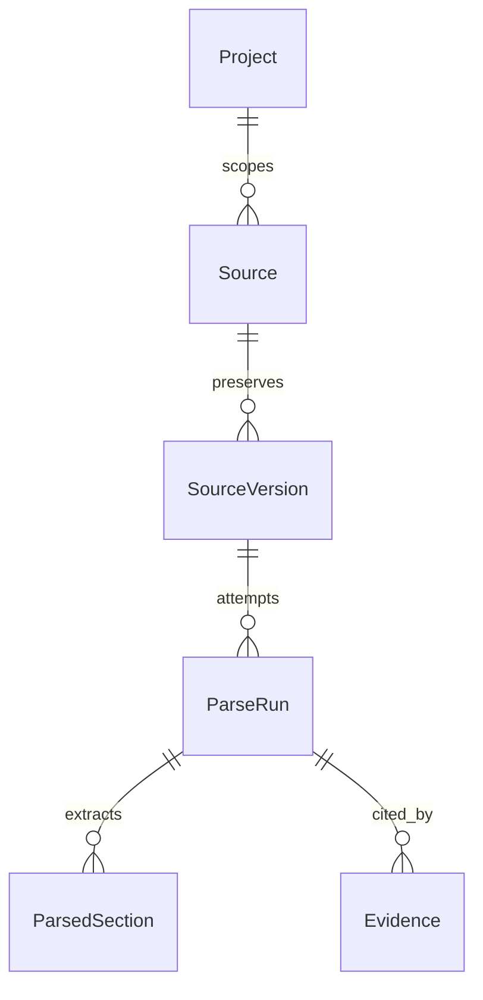

# Data model — foundation, ingestion and future domain

## Implemented Phase 2 schema

`0003_ingestion` and `0004_ingestion_guards` extend accepted Phase 1. [Detailed contract](INGESTION_AND_STORAGE.md).

| Table | Actual fields/integrity |
|---|---|
| sources | UUID/project/code, type/name/description/owner/date/trust/status, optional same-project supersedes ID, revision, creator/timestamps |
| source_versions | UUID/project/source, positive version, filename/generated key/MIME/size/SHA-256/creator/time; immutable, unique key/version |
| parse_runs | UUID/project/source/version, positive attempt, status/name/version/error/metadata/creator/time/completion; immutable identity and terminal result |
| parsed_sections | UUID/project/source/version/parse, positive ordinal, extracted/NFC search text, locator/reference/cells; immutable, GIN full-text index |
| evidence | UUID/project/source/version/parse/code/type, immutable locator/reference/quote, editable summary/class/optional0–1 confidence, server-derived confirmation/at, revision/creator/timestamps |

All lineage FKs include project plus source/version/parse identity. Generated keys must match UUID lineage. RLS grants reads to active members, writes to BA/PROJECT_ADMIN and Evidence confirmation to BUSINESS_OWNER/PROJECT_ADMIN. Insert guards reject pre-confirmed Evidence and sections appended to completed/foreign attempts. Runtime has no history DELETE or raw/section UPDATE. Derived VersionRead parser fields come from newest ParseRun; Evidence stays pinned across replacements/reparses. Metadata edits clear confirmation; provenance corrections create another Evidence. Formal confirmation snapshots, conflict records and trace graph remain future design.



The remaining full domain model below is future design. The Phase 1 foundation and Phase 2 ingestion subsets are migrated. Sources: [development scope](../01_Project_Setup/Medical_BA_AI_MVP_Development_Scope_v1.0.md), [workbook inspection](baseline-inspection.json), domain templates, DEC-MVP-001–007 and DEC-P2-001–006. Policy gaps reference the [decision register](BASELINE_ASSESSMENT.md).

## Implemented Phase 1 schema

| Table | Implemented fields / constraints |
|---|---|
| users | UUID, unique normalized email, Argon2id password_hash, display_name, ACTIVE/INACTIVE status, separate is_system_admin, created_at/updated_at |
| auth_sessions | UUID, User FK, unique SHA-256 opaque-token digest, creation/absolute expiry/revocation timestamps |
| projects | UUID, unique stable PRJ sequence code, name/description/organization/status/scope/out_of_scope, revision, creator FK and timestamps |
| project_members | UUID, project/user/creator FKs, canonical project role, ACTIVE/INACTIVE status, revision/timestamps; unique project/user and project/id |
| audit_logs | UUID, mandatory project FK, actor User FK, action, typed entity ID, timestamp, safe JSONB metadata; append-oriented and RLS protected |
| security_events | UUID, nullable actor User FK, action, timestamp; platform login/logout/bootstrap/provisioning events, no project payload |

`0001_foundation` creates these tables, indexes/checks, RLS predicates/policies and immutable identity/audit triggers. `0002_project_codes` allocates display codes independently from UUIDs and preserves existing identifiers. Downgrade and fresh re-upgrade are exercised on the dedicated `_test` database. Runtime grants are explicit after migrations; no schema changes happen during application startup.

One project role per membership is the Phase 1 interpretation (**ASSUMPTION — NEEDS CONFIRMATION**), and users can have different roles in different projects. A later role-association table can extend this without changing User/Project/Member identities. Creator receives PROJECT_ADMIN; no system role or stakeholder name grants project access. Password hashes have no response schema field. Current scope fields are plain text; audit records actor/revision changes rather than sensitive content copies. Full context snapshots/stakeholders/policy revisions remain future work under the user's narrowed Phase 1 entity scope.

DEC-MVP-006 supersedes A03: CR mandatory after BASELINED only; all historical requirement versions remain immutable. DEC-MVP-007 sets clinical_review_required=false by default; a clinical flag requires Medical SME review before approval/baseline. Requirement/review/CR tables are not implemented in Phase 1.

## Shared conventions

- Internal IDs: UUID primary keys. Project-local display codes preserve `SRC-`, `EVD-`, `REQ-`, `BRULE-`, `DEC-`, `Q-`, `ASM-`, `RSK-`, `DATA-`, `PERM-`, `INT-`, `NFR-`, `TRC-`, `CR-`, `UAT-`, `AI-T`, `AINC-` conventions; project code is globally unique. Allocate counters transactionally, not using row counts. Preserve imported display IDs separately if needed.
- Each project-owned row has `project_id UUID NOT NULL REFERENCES projects(id)`; `projects.id` is its project boundary. `users`, `auth_sessions`, global role definitions and platform security events are infrastructure exceptions, never stores for project content.
- Common mutable metadata: `created_at/updated_at timestamptz`, `created_by/updated_by UUID`, `status` with an entity-specific CHECK, `lock_version bigint`. Record actor kind HUMAN/AI/SYSTEM; an AI action identifies its initiating user and analysis run. Reviewed content, source versions, confirmations, review events and audit are append-oriented and do not need mutable `updated_at`.
- Content is UTF-8 text; dates are `date`; timestamps are UTC `timestamptz`. UUIDs/statuses/authority/references are typed columns, not arbitrary JSON. JSONB is appropriate for parser locations, ordered flows, schema-validated payloads and snapshots. Confidence is optional HIGH/MEDIUM/LOW to match the workbook; provider scores may be retained separately with their scale, never treated as approval.
- Each project table exposes `UNIQUE(project_id,id)`. Every project-owned FK is composite, e.g. `(project_id, source_version_id) REFERENCES source_versions(project_id,id)`. Apply this to self-references, reviews, provenance, relations, analysis, impact, UAT and artifacts. Global user FKs also require authorized membership at action time; preserve attribution after membership ends.
- Use `UNIQUE(project_id,display_code)` on identities and `UNIQUE(project_id,parent_id,revision_number)` on versions. FK deletes RESTRICT history. Project_id never changes; no cross-project move. Archiving/superseding replaces ordinary destructive deletion. Retention/deletion exceptions require A15.
- `revision_number` is monotonic and internal; `version_label` is the visible `0.1`/`1.0` convention. A label is never an approval flag. Mutable lifecycle projections are derived from append-only events; content rows are immutable. Approval/baseline always references a content revision.

## Identity, access and context

| Entity → table | Principal fields and relationships |
|---|---|
| User → users | normalized unique login, display_name, credential/identity-provider reference, status; no patient profile |
| AuthSession → auth_sessions | user_id, hashed opaque token, expiry/revocation timestamps; never plaintext session tokens in DB/logs |
| Project → projects | code, name, organization, module, status PLANNING/ACTIVE/ON_HOLD/CLOSED, current_context_revision_id; creator; unique code |
| ProjectMember → project_members | project_id, user_id, membership status; UNIQUE(project_id,user_id) |
| ProjectMemberRole → future role association | Phase 1 uses a role column: PROJECT_ADMIN/BA/BUSINESS_OWNER/MEDICAL_SME/TECH/QC/VIEWER; future multi-role grants must preserve the same authority boundaries |
| ReviewCapabilityAssignment → review_capability_assignments | member_id, gate kind, grant/revoke attribution; explicit Security/Compliance/Finance assignment proposal under A04 |
| ProjectContextRevision → project_context_revisions | project_id, revision, scope_in/out, business_need/outcomes, constraints, current/downstream systems, owner_stakeholder_ids via typed join, glossary/context references, policy revision |
| ProjectPolicyRevision → project_policy_revisions | clinical review mode, explicit required gates, approval/baseline authority references; revision captured by reviews; values require policy decisions, no waiver of mandatory clinical impact gate |
| Stakeholder → stakeholders | name/role, department/type, influence, interest, decision_authority description, engagement_plan, optional linked user_id |

Platform security events cover login/bootstrap without a fake project_id. Membership grants/revocations create project audit events. A business owner's name is not authenticated approval; its linked user must have an authorized gate capability.

## Sources, evidence and grounding

| Entity → table | Principal fields and constraints |
|---|---|
| Source → sources | display_code, semantic type, name, owner_stakeholder_id, source_date nullable, original_location, trust_level, status ACTIVE/SUPERSEDED/ARCHIVED, current_version_id, supersedes_source_id; source lifecycle does not equal business approval |
| SourceVersion → source_versions | source_id, revision, original_filename, detected_format/MIME, storage_key, sha256, byte_count, uploaded_by/at; immutable original, unique storage key; composite FK ensures current version belongs to that source |
| ParseAttempt → parse_attempts | source_version_id, parser/version, state PENDING/RUNNING/SUCCEEDED/FAILED/UNSUPPORTED, started/finished, sanitized error, extraction_manifest, job_id; retries append attempts |
| KnowledgeChunk → knowledge_chunks | source_version_id, successful_parse_attempt_id, ordinal, text, exact_location JSONB, text hash; unique within parse attempt |
| ChunkEmbedding → chunk_embeddings | chunk_id, embedding_model/version, dimensions, vector (when enabled); unique chunk/model version; indexes only after measured need |
| Evidence → evidence | code, source_version_id, source_id constrained to same version parent, exact_location, extract_text, optional summary, classification, confidence, origin_run_id, status; corrections append replacement evidence linked by supersedes_id |
| HumanConfirmation → human_confirmations | target_node_id/content_hash, assertion, confirmed_by, authority/gate, confirmed_at, optional source/evidence references through provenance; never accepted directly from model output |
| ProvenanceLink → provenance_links | target_node_id plus exactly one source_version_id/evidence_id/human_confirmation_id, supported_claim locator, created_by; CHECK exactly one supporting reference, all same project |
| Conflict → conflicts | description, status OPEN/RESOLVED, detected_run_id, resolution_decision_id nullable; resolution needs human authority |
| ConflictItem → conflict_items | conflict_id, node_id, claim locator; at least two conflicting claims validated by service |
| SourceAccessGrant → source_access_grants | optional source_id and permitted member/capability; only if A06 defines restricted sources; source/derived access must remain consistent |

Location examples: `{page, start_offset, end_offset}`, `{sheet, cell_range}`, `{paragraph, table, row, cell}`, `{line_start,line_end}`, or `{timestamp_start,timestamp_end}` when genuinely present in input. Do not fabricate unavailable coordinates. Every evidence link stays pinned to the original version even after another becomes current.

## BA domain and requirement content

| Entity → table(s) | Principal fields and relationships |
|---|---|
| Requirement → requirements | code, type BUSINESS/STAKEHOLDER/FUNCTIONAL/NFR/TRANSITION, owner_stakeholder_id, current_approved_version_id, current_baseline_version_id, working_version_id, optional parent_requirement_id; all pointers constrained to this identity |
| RequirementVersion → requirement_versions | requirement_id, revision, version_label, title, description, rationale, priority MUST/SHOULD/COULD/WONT, actors, trigger/preconditions, main/alternative/exception flows, clinical_review_required, required gate set, content_hash, predecessor_version_id, change_request_id nullable, origin_output_item_id; content immutable |
| RequirementLifecycleEvent → requirement_lifecycle_events | requirement_version_id, from/to status, actor, reason, review/CR references, timestamp; current status projection is locked and backend-managed |
| BusinessRule → business_rules / business_rule_versions | stable code/owner; version content, type VALIDATION/CALCULATION/ELIGIBILITY/WORKFLOW/TIMING/STATUS/OTHER, status DRAFT/CONFIRMED/APPROVED/SUPERSEDED, clinical flag, predecessor and provenance |
| AcceptanceCriteria → acceptance_criteria | requirement_version_id, ordinal, scenario kind, Given/When/Then or structured condition, business_rule_version_id nullable, review state, content_hash, predecessor_ac_id; version-specific and immutable after review |
| UserStory → user_stories | requirement_version_id, actor, capability, value, content_hash; draft status until associated version approved; may be represented alongside AC in UI |
| Question → questions | code, text, priority BLOCKING/IMPORTANT/NICE_TO_HAVE, assigned_stakeholder_id, due_date nullable, status OPEN/ANSWERED/CLOSED/CANCELLED, origin_output_item_id; related nodes via trace |
| QuestionAnswer → question_answers | question_id, answer, answered_by/at, human_confirmation_id or supporting provenance, supersedes_answer_id; append-only; a proposed AI answer cannot close a question |
| Assumption → assumptions | code, statement, reason, risk_if_wrong, who_must_confirm, status OPEN/CONFIRMED/REJECTED/SUPERSEDED, confirmation_id; confirmed assumption still retains its origin and does not auto-create approval |
| Decision → decisions | code, text, reason, alternatives, maker_stakeholder_id, recorded_by, authorized_by, decision_date, status PROPOSED/ACTIVE/SUPERSEDED/REVOKED, supersedes_decision_id; frozen text when activated, explicit replacement needed |
| Risk → risks | code, type BUSINESS/CLINICAL/PATIENT_SAFETY/OPERATIONAL/DATA/SECURITY/INTEGRATION/REGULATORY/MIGRATION, description, impact, severity CRITICAL/HIGH/MEDIUM/LOW, mitigation, owner, status OPEN/MITIGATED/ACCEPTED/CLOSED; acceptance authority A11 |
| ActionItem → action_items | action, owner_stakeholder_id, due_date nullable, state, origin_output_item_id; supports meeting classification without inventing tasks |

Question/assumption/risk changes retain domain revision snapshots/events and audits. Related IDs use trace nodes, not unrestricted string fields. Notes and unsupported proposals remain labeled. Provenance is many-to-many so a requirement can have several supporting passages and confirmations.

## Analyzed specifications, terminology and UAT

| Entity → table | Principal fields and relationships |
|---|---|
| DataDictionaryEntry → data_dictionary_entries | code, revision, entity_name, field_name, business_name, data_type, required YES/NO/CONDITIONAL, allowed_values, validation, sensitive flag, source_system, owner, source_of_record, retention/migration notes, status |
| RolePermission → role_permissions | code, revision, business_role, feature, action, permission ALLOW/DENY/CONDITIONAL, condition, status; documents target-system rules, never grants this app's access |
| Integration → integrations | code, revision, source/destination system, trigger, direction, sync_mode, method/event/endpoint, auth description (no credentials), request/response schema, timeout/retry requirements nullable/TBD, errors/idempotency/duplicate handling, status DRAFT/CONFIRMED/APPROVED/IMPLEMENTED/DEPRECATED |
| IntegrationMapping → integration_mappings | integration revision ID, source_field, target_field, meaning, required, transformation, business_rule_version_id |
| NFRDetail → nfr_details | requirement_version_id UNIQUE, NFR display code, category, metric/target nullable, target_confirmation/provenance, measurement_method; type of owning requirement must be NFR |
| GlossaryTerm → glossary_terms | code, revision, term, general_definition, project_meaning, status ACTIVE/SUPERSEDED/RETIRED, provenance; no automatic global cross-project glossary |
| RegulationReference → regulation_references | code, revision, title, version/number, jurisdiction, effective_date, applicable_scope, official_source, last_reviewed, status ACTIVE/SUPERSEDED/REPEALED/REVIEW_NEEDED; mandatory project_id |
| UATScenario → uat_scenarios | code, requirement_version_id, related_ac_id, scenario, preconditions, steps, expected_result, draft/review metadata; expected rules need provenance |
| UATResult → uat_results | scenario_id, status NOT_RUN/PASS/FAIL/BLOCKED/RETEST, tester, date, environment, actual_result, evidence, business_signoff_id; minimal record, not a full testing platform |

Specifications that appear in a reviewed requirement or artifact are pinned by revision, not by “latest” text. Changes append revisions and preserve old content. `TBD` is a presentation of an unknown field with an optional blocking question; it is never coerced to a numeric zero/default SLA.

## Review and lifecycle rules

Review → `reviews`: project_id, target_node_id, content_hash, dependency_digest, policy_revision_id, gate BA/BUSINESS/MEDICAL/TECH/SECURITY/COMPLIANCE/(FINANCE if assigned), reviewer_user_id, reviewer capability snapshot, outcome APPROVED/REJECTED/NEEDS_CHANGES, concise comment, created_at. ReviewRequest → `review_requests`: target version, gate, assigned member, status PENDING/COMPLETED/CANCELLED. UI labels BA_REVIEWED/BUSINESS_REVIEWED/MEDICAL_REVIEWED are derived from independent completed gates; NOT_REQUIRED requires policy evidence and cannot bypass clinical impact.

Dependency digest covers version-pinned rules/AC/support and required gates so changing a material link after review cannot retain stale approval. Approvals are distinct audit events even if review and approval are submitted together. A model/service principal cannot create a human Review or HumanConfirmation. A successful Medical review does not substitute for Business approval.

| Transition | Baseline meaning and proposed preconditions |
|---|---|
| DISCOVERED → DRAFT | BA chooses a candidate; AI may create DRAFT directly with origin metadata |
| DRAFT → UNDER_ANALYSIS | Analysis starts on this version |
| UNDER_ANALYSIS → WAITING_BUSINESS | Record required questions/review requests |
| WAITING_BUSINESS → CONFIRMED | Authorized confirmation; related blocking gaps answered and validated, unresolved conflicts blocked |
| CONFIRMED → APPROVED | Human business approval; valid BA + Business + required Medical/Tech/Security/Compliance gates, provenance, no relevant unresolved blocking gaps/conflicts |
| APPROVED → BASELINED | Authorized human baseline command, same reviewed content/dependencies, recorded version label |
| BASELINED → IMPLEMENTED → VERIFIED → RELEASED | Human-recorded development/testing/release evidence; no automatic deployment or approval by AI |
| Pre-approval → REJECTED | Attributable rejection reason; allowed origins/authority A11 |
| Current approved/baselined → SUPERSEDED | Explicit qualified replacement; retain history and downstream stale-link flags |
| Current published → DEPRECATED | Human decision/reason, controlled CR where required; preserve references |

**ASSUMPTION — NEEDS CONFIRMATION (A11):** only the displayed forward progression is the initial allowed path. Shortcuts/backtracking and terminal-state origins require explicit policy before implementation. Rework creates a new draft content revision with fresh review; no historical-content mutation. DEC-MVP-006 permits controlled pre-baseline editing and mandates CR after BASELINED. Status, current pointers, dependency validity and audit are checked/committed in one transaction with row locks or compare-and-swap. Database constraints/triggers will protect immutable baseline content; migration owner privileges are not runtime privileges.

Decision transitions: PROPOSED → ACTIVE only via authorized human confirmation; ACTIVE → SUPERSEDED only when an explicitly linked replacement becomes ACTIVE; ACTIVE → REVOKED via authorized human action. No cycles/self-supersession. A newer document alone never activates a decision. Record revoked/superseded history; exact reactivation policy A11 remains undefined.

## Traceability and integrity

TraceNode → `trace_nodes(project_id,id,node_type,created_at,status)`: a small identity registry enabling FK-backed edges. Business content stays in dedicated tables above; it is not stored in a universal JSON object table. Concrete traceable rows carry `node_id` and a checked `node_type`, with composite FK to the registry. Versioned content gets distinct nodes per revision; stable identities support navigation and point to their active revision.

**ASSUMPTION — NEEDS CONFIRMATION (A07):** use deferred integrity triggers, alongside unique node IDs and type checks, to enforce exactly one corresponding concrete entity for every registry node. The Phase 6 migration must test dangling registry records, wrong-type registration, direct SQL writes and missing content. Do not rely on polymorphic `(type,id)` strings alone. Nodes cannot be hard-deleted while referenced.

TraceLink → `trace_links`: code, from_node_id, relation, to_node_id, status ACTIVE/BROKEN/SUPERSEDED, reason, origin_run_id, created_by, confirmed_by where applicable. Composite FKs on both ends prevent cross-project edges. Unique active `(project_id,from_node_id,relation,to_node_id)`; reject self edges for supersession and cycles for parent/supersede relations. General graph traversal is bounded and cycle-safe. Relation types: SUPPORTS, DERIVED_FROM, ANSWERS, SUPERSEDES, IMPLEMENTS, VALIDATES, AFFECTS.

RequirementRelation is a typed view/API over TraceLink when both endpoints are requirement identities/versions, preserving a single edge authority. Parent requirement relationships have a dedicated FK and corresponding derived graph relation. Typed FK relationships (source/version/evidence, requirement/AC) yield canonical graph edges automatically in the same transaction, not by optional manual user entry. Broken status also covers stale superseded support and unresolved imported links; raw imported invalid targets stay in validation findings until resolved, not as FK violations in live graph.

Minimum navigable paths: Source → Evidence → Requirement; Decision → Requirement; BUSINESS → STAKEHOLDER → FUNCTIONAL requirements; Requirement → BusinessRule/Data/Permission/Integration/NFR/AC/UAT; CR → affected records; Artifact → exact input versions. Both inbound and outbound indexes use `(project_id,node_id,status)`.

## Change and artifacts

| Entity → table | Principal fields and constraints |
|---|---|
| ChangeRequest → change_requests | code, requested_change, current_state, reason, requester, priority MUST/SHOULD/COULD, status OPEN/UNDER_ANALYSIS/APPROVED/REJECTED/IMPLEMENTED/CLOSED, risk/open_question summary, target_release, approving_decision_id, approved_impact_analysis_id |
| ChangeTarget → change_targets | change_request_id, old_node_id/version, proposed_change; unique CR/target |
| ImpactAnalysis → impact_analyses | CR id, revision, graph_snapshot/hash, source context, ai_run_id nullable, summary, state DRAFT/CONFIRMED, human confirmer/time |
| ImpactItem → impact_items | analysis_id, node_id, category, direct/indirect, dependency path, rationale/support, suggested/confirmed/dismissed, reviewer/reason; record gaps separately when target unknown |
| ChangeApplication → change_applications | CR id, confirmed analysis id, old_version_id, new_draft_version_id, actor/time, idempotency key; rejects stale target snapshots |
| Artifact → artifacts | kind, revision, label DRAFT/OFFICIAL, generated_by/at, template_version, source_snapshot_hash, storage_key, format, checksum, prior_artifact_id, optional CR id; immutable output |
| ArtifactInput → artifact_inputs | artifact_id, node_id/revision, selection status and content hash; source/requirement/rule/AC/UAT references all pinned |

CR approval requires the human-confirmed impact revision and authorized decision. Applying an approved CR creates drafts only. Replacement approval/baseline independently requires reviews. Official artifact generation reads a consistent snapshot and excludes stale/superseded inputs from current selection. Historical artifacts keep their pinned inputs; a CR can produce a draft alongside the still-current baseline. No destructive rewrite.

## AI, jobs, audit and evaluation

| Entity → table | Principal fields and relationships |
|---|---|
| AIAnalysisRun → ai_analysis_runs | project_id, initiating user, type, state, provider/model, prompt/schema version, context/policy revision, previous_run_id, knowledge snapshot hash, job_id, start/end, sanitized failure, structured summary |
| AIAnalysisInput → ai_analysis_inputs | run_id, source_version/evidence/confirmation/node reference (exactly one), context role; complete reproducible source manifest |
| AIOutputItem → ai_output_items | run_id, ordinal, classification (seven values), proposed_entity_kind, content, concise rationale, references via provenance, confidence, review/clinical flags, schema-validated details, validation state; UNIQUE(run_id,ordinal) |
| OutputPromotion → output_promotions | output_item_id, destination_node_id, promoted_by, timestamp; unique intended promotion key; destination starts draft/proposed |
| AIReviewFeedback → ai_review_feedback | run/output target, human reviewer, CORRECT/NEEDS_REVISION/UNSAFE/UNSUPPORTED, comment, review timestamp; preserves human review result |
| AIEvaluationCase → ai_evaluation_cases | project_id, code, revision, category, synthetic input/fixture refs, expected_behavior, forbidden_behavior, evaluator definition, regression flag; immutable case revisions |
| AIEvaluationRun / Result → ai_evaluation_runs / ai_evaluation_results | run initiator/model/prompt/knowledge versions; per-case actual output refs, verdict NOT_RUN/PASS/FAIL/BLOCKED, reviewer/rationale, run timestamps; never overwrite prior runs |
| AIIncident → ai_incidents | code, run/output ref, sanitized input context, wrong/expected output refs, severity, impact, root cause/fix, regression_case_id, owner, status OPEN/INVESTIGATING/FIXED/CLOSED |
| Job → jobs | project_id, requested_by, job_type, state, target_id, idempotency_key, lease/attempt fields, sanitized error, timestamps; no cross-project batch payload |
| AuditLog → audit_logs | project_id, actor_user_id/kind, action, object_node/typed ID, before/after status or revision references, reason, timestamp, request/run correlation; append only, redact content/secrets |
| AIConversation / Message | If conversation UI is later selected, both must have project_id, authorized user and run/source refs; no unscoped conversation cache. Not required to add chat for MVP analysis reruns |

AIEvaluation golden fixtures in the repository are synthetic test assets. Persisted evaluation cases/runs/results have a project boundary even though the workbook omits it. Platform events have their own separate table and cannot contain private project documents. All application writes affecting review, approval, baseline, supersession, CR, permission or AI output commit audit in the same transaction. Append-oriented audit is not a claim of cryptographic tamper-proofing against DB administrators.

## Core relationships

```mermaid
erDiagram
  User ||--o{ ProjectMember : joins
  Project ||--o{ ProjectMember : permits
  Project ||--o{ Source : owns
  Source ||--|{ SourceVersion : preserves
  SourceVersion ||--o{ Evidence : locates
  Project ||--o{ Requirement : owns
  Requirement ||--|{ RequirementVersion : versions
  RequirementVersion ||--o{ AcceptanceCriteria : specifies
  RequirementVersion ||--o{ Review : requires
  RequirementVersion ||--o{ UATScenario : validates
  TraceNode ||--o{ TraceLink : from
  TraceNode ||--o{ TraceLink : to
  TraceNode ||--o{ ProvenanceLink : supported_by
  Evidence ||--o{ ProvenanceLink : supports
  HumanConfirmation ||--o{ ProvenanceLink : confirms
  ChangeRequest ||--|{ ChangeTarget : affects
  ChangeRequest ||--o{ ImpactAnalysis : analyzes
  ImpactAnalysis ||--o{ ImpactItem : contains
  Artifact ||--|{ ArtifactInput : pins
  AIAnalysisRun ||--o{ AIOutputItem : proposes
  AIEvaluationRun ||--o{ AIEvaluationResult : measures
  AIEvaluationCase ||--o{ AIEvaluationResult : executes
```

Diagram shows principal cardinalities, not every mandatory project FK. Review targets the version's TraceNode; provenance and other joins use composite keys throughout.

## Indexes and migration sequence

Index project/status/date for register lists, project/owner for work queues, project/source/version for evidence/chunks, graph inbound/outbound edges, active membership, version/current-pointer lookups, audit project/time, job state/lease and evaluation run/case. Use partial unique indexes for current records where appropriate. Pin indexes and enum/check changes in Alembic; migration and runtime roles are separate.

Migrations start Phase 1, not Phase 0: identity/projects/membership/context/audit → knowledge and provenance → BA entities/specifications → AI run/output contracts → reviews and immutable baselines → graph registry/edge constraints → CR/impact/version application → artifact manifests → evaluation/incidents and hardening. Introduce a minimal node/provenance foundation early where needed, then extend types in later migrations; never ship dangling references awaiting a later phase.

Each migration phase tests fresh install and upgrade from the prior revision on PostgreSQL, constraints and tenant policies, and rollback feasibility on disposable data. Baseline/history deletion is never used as an upgrade shortcut. Phase 0 applied no migrations; Phase 1 has applied and tested 0001/0002 on actual PostgreSQL.
